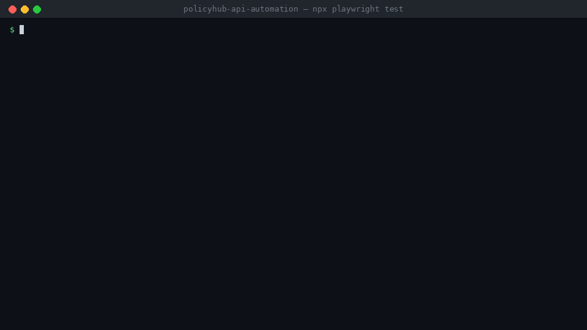
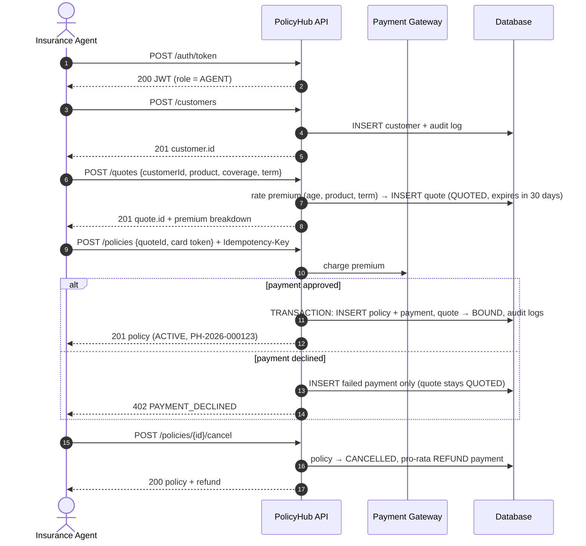
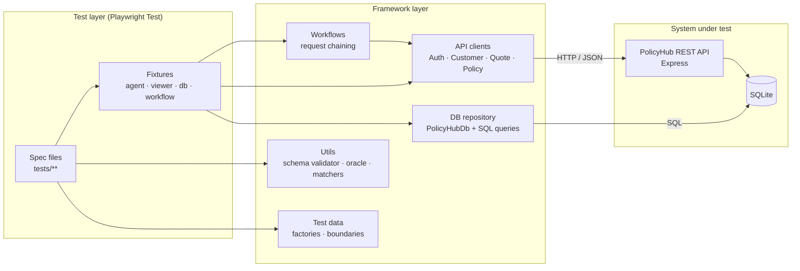

# PolicyHub API Automation

[](https://github.com/Sadia-Sultana-Bristy/policyhub-api-automation/actions/workflows/api-tests.yml)


An API test automation framework for **PolicyHub**, an insurance platform that sells AUTO and HOME policies.
The tests cover the full business process, **customer onboarding → quote → purchase → cancellation**, and check
the REST API and the **database records** behind it.

Built with **Playwright `APIRequestContext`**, **JavaScript**, **JSON Schema contract validation**, **SQL assertions** and **GitHub Actions**.

## Test run demo



*A real recording of the full suite running in one worker and slowed down 3× so each test is readable, followed by `npm run report:summary` building the report from the same run. Lines are shortened to the file name and test title.*

**Latest results:** every push runs all 114 tests on Node 22 and 24. See the [GitHub Actions runs](https://github.com/Sadia-Sultana-Bristy/policyhub-api-automation/actions/workflows/api-tests.yml), open any green run to see the summary on the job page, and download the HTML report from **Artifacts**.

---

## Table of contents

- [Test run demo](#test-run-demo)
- [What this project demonstrates](#what-this-project-demonstrates)
- [Business workflow](#business-workflow)
- [Architecture](#architecture)
- [Project structure](#project-structure)
- [Getting started](#getting-started)
- [Running tests](#running-tests)
- [Test coverage](#test-coverage)
- [Framework highlights (with code)](#framework-highlights)
- [Reports](#reports)
- [CI/CD](#cicd)
- [Configuration](#configuration)
- [Documentation](#documentation)

---

## What this project demonstrates

| Skill | Where to look |
|---|---|
| REST API testing (status codes, headers, bodies) | `tests/**` |
| JWT authentication, token caching and role-based access | `utils/tokenManager.js`, `tests/auth/` |
| **Request chaining** across a multi-step business flow | `tests/integration/policy-lifecycle.spec.js`, `api/workflows/` |
| Contract testing with JSON Schema (AJV) | `api/schemas/`, `utils/schemaValidator.js` |
| **Database verification with SQL** (multi-table JOINs, integrity checks) | `database/` |
| Business-rule validation with an independent test oracle | `utils/premiumCalculator.js`, `data/pricing-rules.json` |
| Positive, negative, boundary-value and error-format testing | `@negative`, `@boundary` tags |
| Idempotency, double-submit and concurrency testing | `tests/policies/purchase.spec.js` |
| Test data factories (unique, parallel-safe data) | `data/factories/` |
| Custom Playwright fixtures and matchers | `tests/fixtures/`, `utils/assertions.js` |
| CI/CD with matrix builds, artifacts and job summaries | `.github/workflows/api-tests.yml` |

---

## Business workflow



### Business rules under test

| Rule | Value |
|---|---|
| Customer age at onboarding | 18 – 75 |
| Products | `AUTO` (base rate 3.5%), `HOME` (base rate 1.2%) |
| Coverage amount | 10,000 – 1,000,000 USD |
| Policy term | 6, 12 or 24 months (factor 0.55 / 1.0 / 1.9) |
| Age factor | 18–24 → 1.6 · 25–64 → 1.0 · 65–75 → 1.3 |
| Premium | `annual = coverage × baseRate × ageFactor`, `total = annual × termFactor` |
| Quote validity | 30 days, then it can no longer be purchased |
| One policy per quote | Enforced via status + DB unique constraint + idempotency |
| Cancellation refund | Pro-rata on unused days |

---

## Architecture



**Layers**

1. **Specs** contain only test intent and assertions. They contain no URLs, raw HTTP calls or SQL.
2. **API clients** (one per resource) wrap `APIRequestContext`. They add the auth header and API version prefix, and never throw on 4xx/5xx, so negative tests can assert on those responses.
3. **Workflows** chain calls into business preconditions (`workflow.activePolicy()`), so a cancellation test does not repeat setup code.
4. **Database layer**: a generic `DbClient` plus a `PolicyHubDb` repository with named, parameterised SQL.
5. **Mock backend** (`mock-server/`) is a realistic Express + SQLite implementation of the API. With it, the suite runs anywhere with **zero external dependencies**: locally, in CI, or in an interview demo. To test a real environment, set `BASE_URL` and `START_LOCAL_SERVER=false`.

---

## Project structure

```
policyhub-api-automation/
├── tests/                      # Test specifications, grouped by business capability
│   ├── fixtures/index.js       #   custom fixtures: agent, viewer, anonymous, db, workflow, tokenManager
│   ├── auth/                   #   login, JWT validation, expired/tampered tokens, RBAC
│   ├── customers/              #   onboarding, validation, age & length boundaries, duplicates
│   ├── quotes/                 #   premium rating matrix, coverage boundaries, invalid input
│   ├── policies/               #   purchase, payments, idempotency, concurrency, cancellation/refunds
│   ├── integration/            #   end-to-end lifecycle + cross-table DB integrity
│   └── platform/               #   health, correlation IDs, 404 format, security headers
├── api/                        # API layer
│   ├── clients/                #   BaseApiClient + one client per resource
│   ├── schemas/                #   JSON Schemas (response contracts)
│   ├── workflows/              #   PolicyWorkflow: reusable request chains
│   ├── ApiResponse.js          #   response wrapper (parsed body, timing, describe())
│   └── index.js                #   createApiClients(request, token)
├── data/                       # Test data
│   ├── factories/              #   buildCustomer / buildQuote / buildPurchase (unique per call)
│   ├── pricing-rules.json      #   business rules used by the test oracle
│   └── test-data.js            #   payment tokens, enums, boundary-value tables
├── utils/                      # Cross-cutting helpers
│   ├── assertions.js           #   custom matchers: toHaveStatus, toMatchSchema, toRespondWithin, expectApiError
│   ├── schemaValidator.js      #   AJV + formats
│   ├── premiumCalculator.js    #   independent premium / refund oracle
│   ├── tokenManager.js         #   per-role token cache with auto-refresh
│   ├── dateUtils.js            #   UTC date maths (dobForAge, addMonths…)
│   ├── idempotency.js          #   idempotency key generator
│   └── reportSummary.js        #   Markdown summary from JSON report (+ GitHub job summary)
├── database/                   # Database validation layer
│   ├── DbClient.js             #   generic SQL client (query / one / scalar / execute)
│   ├── PolicyHubDb.js          #   domain repository used by tests
│   └── queries.js              #   named SQL (JOINs, aggregates, integrity checks, test setup)
├── config/
│   └── env.js                  # single source of configuration (env vars + .env + defaults)
├── mock-server/                # System under test: Express API + SQLite schema
├── reports/                    # Generated reports (HTML, JUnit, JSON, summary.md)
├── docs/                       # Test strategy, API reference, portfolio content
├── .github/workflows/          # GitHub Actions pipeline
├── playwright.config.js
├── .env.example
├── package.json
└── README.md
```

| Folder | Purpose |
|---|---|
| `tests/` | What is being verified. Each spec maps to one business capability and reads like a test case. Tags (`@smoke`, `@negative`, `@boundary`, `@db`, `@e2e`, `@security`) allow selective runs. |
| `api/` | How we talk to the API. Specs never build URLs or headers themselves, so an endpoint change is fixed in one place. |
| `data/` | What we send. Factories generate unique, valid payloads so tests can run in parallel without collisions. Boundary tables keep BVA data in one reviewable place. |
| `utils/` | Reusable logic: custom assertions, schema validation, the business-rule oracle, auth token handling and reporting. |
| `database/` | How we verify the backend. All SQL lives here, so specs call `db.getPolicy(id)` and never write SQL inline. |
| `config/` | Environment configuration. The same tests run locally, in CI or against staging just by changing env vars. |
| `reports/` | Output of every run: interactive HTML, JUnit XML (for CI tools), JSON and a Markdown summary. |
| `.github/workflows/` | CI pipeline: runs on push, PR, a nightly schedule and on demand. |

---

## Getting started

**Prerequisites:** Node.js 22.13+ and npm. The database uses Node's built-in `node:sqlite`, so there are no native modules or build tools to install.

```bash
git clone https://github.com/Sadia-Sultana-Bristy/policyhub-api-automation.git
cd policyhub-api-automation
npm install
cp .env.example .env      # optional, defaults work out of the box
```

No browser download is needed, because these are pure API tests.

---

## Running tests

Playwright starts the PolicyHub API automatically (`webServer` in `playwright.config.js`) with a fresh database.

| Command | What it runs |
|---|---|
| `npm test` | Full suite (114 tests) |
| `npm run test:smoke` | Critical-path smoke tests |
| `npm run test:negative` | Negative / error-handling tests |
| `npm run test:boundary` | Boundary-value tests |
| `npm run test:db` | Tests with database assertions |
| `npm run test:e2e` | End-to-end lifecycle tests |
| `npm run test:auth` | Authentication and authorization |
| `npm run report` | Open the HTML report |
| `npm run report:summary` | Print and save the Markdown summary |

Other useful options:

```bash
npx playwright test tests/policies/purchase.spec.js        # one file
npx playwright test -g "idempotency"                       # by title
npx playwright test --grep "@db" --grep-invert "@pricing"  # combine tags
npm run start:server                                       # run the API alone (http://localhost:3000/api/v1)
```

Run against a deployed environment:

```bash
START_LOCAL_SERVER=false TEST_ENV=staging BASE_URL=https://staging.example.com npm test
```

---

## Test coverage

| Area | Tests | Positive | Negative | Boundary | DB check |
|---|---:|:-:|:-:|:-:|:-:|
| Authentication & RBAC | 14 | ✅ | ✅ | | ✅ |
| Customers | 33 | ✅ | ✅ | ✅ | ✅ |
| Quotes & pricing | 31 | ✅ | ✅ | ✅ | ✅ |
| Policy purchase & payments | 17 | ✅ | ✅ | ✅ | ✅ |
| Cancellation & refunds | 12 | ✅ | ✅ | | ✅ |
| End-to-end integration | 3 | ✅ | | | ✅ |
| Platform | 4 | ✅ | ✅ | | |
| **Total** | **114** | | | | |

**Notable scenarios**

- 🔐 Tampered JWT (role escalation from VIEWER to AGENT), wrong signing secret, expired token, and no user enumeration on login
- 💳 Declined and insufficient-funds payments leave the quote purchasable and issue no policy. A retry with another card succeeds.
- 🔁 Same `Idempotency-Key` replays the original response, so the customer is never charged twice. Reusing a key for a different request returns 422.
- ⚡ 5 concurrent purchase requests for one quote produce exactly one 201 and four 409s, with one policy and one charge in the DB.
- ⏳ Expired quote: set up through SQL (no waiting 30 days), then verified that it is rejected and marked `EXPIRED`
- 💰 Pricing matrix: 2 products × 6 age-band edges, checked against an independent oracle
- 🧾 Pro-rata refund after backdating a policy 100 days via SQL
- 🗄️ A single SQL JOIN verifies customer → quote → policy → payments, and the audit trail is verified in order.

The suite was checked with **fault injection**. Planting a pricing bug (age band 24 vs 25) and a missing status update in the
backend made 6 targeted tests fail, which shows the assertions catch real defects. See [docs/TEST_STRATEGY.md](docs/TEST_STRATEGY.md#7-suite-effectiveness-fault-injection).

---

## Framework highlights

### 1. Fixtures: authenticated clients injected into every test

```js
test('VIEWER cannot create customers, quotes or policies (403)', async ({ viewer, workflow, db }) => {
  const { quote } = await workflow.customerWithQuote();          // chained setup as AGENT
  const purchase = await viewer.policies.purchase({ quoteId: quote.id, payment: { token: 'tok_test_visa' } });

  expectApiError(purchase, { status: 403, code: 'FORBIDDEN' });   // status + code + schema + requestId
  expect(db.getPoliciesForQuote(quote.id)).toHaveLength(0);       // nothing was written
});
```

Tokens are fetched **once per worker per role** and refreshed before expiry (`utils/tokenManager.js`).

### 2. Request chaining with `test.step`

```js
await test.step('2. Create customer', async () => { customer = (await api.customers.create(buildCustomer())).body; });
await test.step('3. Generate quote', async () => { quote = (await api.quotes.create(buildQuote(customer.id))).body; });
await test.step('4. Purchase policy', async () => { policy = (await api.policies.purchase(buildPurchase(quote.id))).body; });
```

### 3. API + database validation in one test

```js
expect(response).toHaveStatus(201);
expect(response).toMatchSchema('policy');
expect(db.getQuote(quote.id).status).toBe('BOUND');
expect(db.getPaymentsForQuote(quote.id)).toEqual([
  expect.objectContaining({ type: 'CHARGE', status: 'SUCCEEDED', amount: quote.premium.totalPremium }),
]);
```

```sql
-- database/queries.js: whole lifecycle in one row
SELECT c.email, q.status, p.policy_number, p.status, p.refund_amount,
       SUM(CASE WHEN pay.type = 'CHARGE' AND pay.status = 'SUCCEEDED' THEN pay.amount ELSE 0 END) AS total_charged,
       SUM(CASE WHEN pay.type = 'REFUND' THEN pay.amount ELSE 0 END)                               AS total_refunded
FROM policies p
JOIN quotes q    ON q.id = p.quote_id
JOIN customers c ON c.id = p.customer_id
LEFT JOIN payments pay ON pay.policy_id = p.id
WHERE p.id = ?
GROUP BY p.id;
```

### 4. Readable failures

The custom matchers print the full request and response when an assertion fails, so a CI failure can be debugged from the report alone:

```
Expected HTTP 201 but got 409
POST /api/v1/policies -> 409 (6 ms)
Request:  {"quoteId":"quo_7c1e...","payment":{"token":"tok_test_visa"}}
Response: { "error": { "code": "QUOTE_ALREADY_BOUND", "message": "A policy has already been issued for this quote" }, "requestId": "..." }
```

---

## Reports

Every run produces:

| Report | Location | Used for |
|---|---|---|
| HTML (interactive, with steps) | `reports/html/index.html` | Local debugging: `npm run report` |
| JUnit XML | `reports/junit/results.xml` | CI test analytics (Jenkins, Azure DevOps, GitLab) |
| JSON | `reports/json/results.json` | Custom dashboards / summary generator |
| Markdown summary | `reports/summary.md` | GitHub Actions job summary |

Examples: [passing run](reports/example-report.md) · [failing run from fault injection](reports/example-failure-report.md), which shows the expected vs received premium diff

```
| Total | Passed | Failed | Flaky | Skipped | Pass rate | Duration |
|------:|-------:|-------:|------:|--------:|----------:|---------:|
|   114 |    114 |      0 |     0 |       0 |    100.0% |     3.6s |
```

---

## CI/CD

`.github/workflows/api-tests.yml`

- **Triggers:** push and PR to `main`, nightly regression (weekdays 08:00 Bangkok time), manual run with a suite selector (`smoke`, `negative`, `boundary`, `db`, `e2e`)
- **Matrix:** Node 22 and 24
- **Secrets:** `JWT_SECRET`, `AGENT_PASSWORD`, `VIEWER_PASSWORD` read from repository secrets
- **Outputs:** Markdown summary on the job page, plus HTML/JUnit/JSON uploaded as artifacts (14-day retention)
- Retries once in CI (flaky-test signal) and uses `forbidOnly` to block an accidental `test.only`

---

## Configuration

All configuration lives in `config/env.js`. Every value can be overridden with an environment variable or a `.env` file (see `.env.example`).

| Variable | Default | Description |
|---|---|---|
| `BASE_URL` | `http://localhost:3000` | API host |
| `API_PREFIX` | `/api/v1` | API version prefix |
| `START_LOCAL_SERVER` | `true` | Start the mock API before tests |
| `TEST_ENV` | `local` | Environment name (some tests need local secrets) |
| `AGENT_USERNAME` / `AGENT_PASSWORD` | `agent.alice` / … | Read-write user |
| `VIEWER_USERNAME` / `VIEWER_PASSWORD` | `viewer.victor` / … | Read-only user |
| `JWT_SECRET` | local value | Token signing secret (mock server + expired-token test) |
| `DB_PATH` | `database/policyhub.db` | Database file used for validation |
| `RESPONSE_TIME_SLA_MS` | `1000` | Max response time asserted on critical endpoints |

---

## Documentation

- [Test strategy](docs/TEST_STRATEGY.md): scope, techniques, risk-based priorities, test data, entry/exit criteria
- [API reference](docs/API_REFERENCE.md): endpoints, payloads, error codes

---

## Author

**Sadia Sultana Bristy**: [GitHub](https://github.com/Sadia-Sultana-Bristy) · [Portfolio](https://sadia-sultana-bristy.github.io)

## License

MIT
